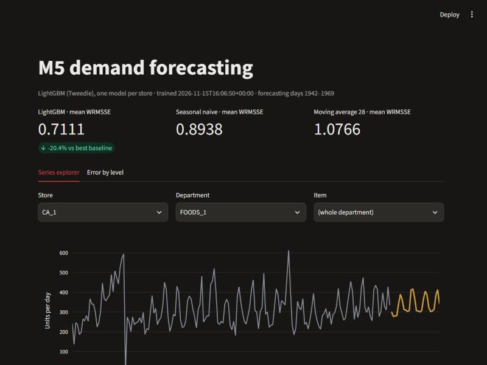
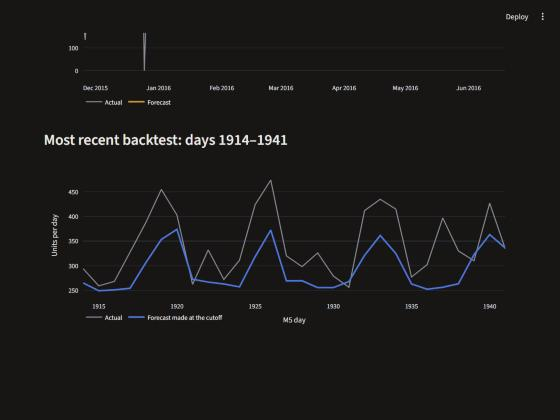
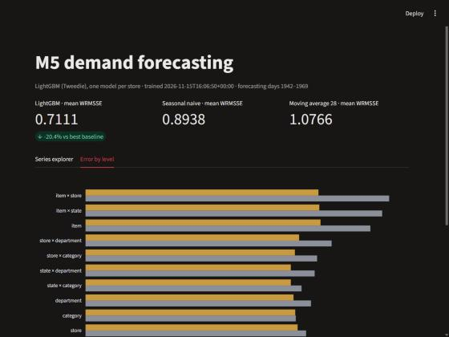
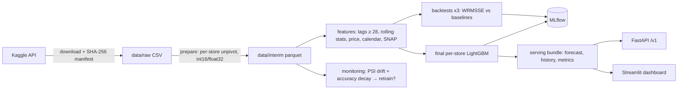

# M5 demand forecasting: end-to-end

Daily unit-sales forecasts, 28 days ahead, for **30,490 Walmart item × store series** (the
[M5 Forecasting – Accuracy](https://www.kaggle.com/competitions/m5-forecasting-accuracy) dataset),
built as a production-style ML system rather than a notebook:

- **Leakage-safe features**, so one model forecasts all 28 days without feeding its own predictions back in
- The **official WRMSSE metric**, re-implemented and unit-tested against hand-calculated values
- **Rolling-origin backtests** against two baselines, all tracked in **MLflow**
- **Per-store LightGBM** (Tweedie loss) that fits in 12 GB of RAM
- A **FastAPI** forecast service, a **Streamlit** dashboard, **Docker**, **CI**, and **drift monitoring** with a retrain trigger

## Results at a glance

Mean WRMSSE over three rolling 28-day backtests across all 30,490 series (lower is better):

| Model | Mean WRMSSE |
|---|---:|
| **LightGBM, Tweedie, one model per store** | **0.7111** |
| Seasonal naive (repeat last week) | 0.8938 |
| Moving average (last 28 days) | 1.0766 |

LightGBM is **20.4% better** than the best baseline, and it wins in every backtest window and at all
12 aggregation levels.

**Kaggle late submission:** private-leaderboard WRMSSE **0.59184** on the competition's hidden test
window (days 1942–1969), submitted 2026-11-15 with `scripts/kaggle_submit.py`. Full tables, with the MLflow run ids behind each number, are in
[RESULTS.md](RESULTS.md), which is generated from MLflow by `python -m m5forecast.report`.

**Monitoring on this data:**
- Sales and price distributions are stable: PSI 0.001 and 0.000.
- The most recent backtest window (days 1914–1941) is 16% harder than the two before it, so the
  accuracy check raises **retrain recommended**. In production, that alert would trigger a retrain
  on fresh data.

## Screenshots

| Forecast vs history | Most recent backtest | Error by aggregation level |
|---|---|---|
|  |  |  |

## Architecture



**Why lags of at least 28 days?** Every sales-based feature on day *t* only uses sales up to day
*t − 28*. So a single model can predict all 28 days directly, and the features don't change with the
backtest cutoff, which means they are built once per store. A test (`tests/test_features.py`) changes
every sale after *t − 28* and checks that day *t*'s features stay exactly the same.

## Quick start

Needs Python 3.12 and [uv](https://docs.astral.sh/uv/). Kaggle data needs an API token
(`~/.kaggle/kaggle.json`), and you must accept the competition rules first.

```bash
uv sync --extra train --extra dashboard       # core (API) + training + dashboard
uv run python scripts/download_data.py        # Kaggle API -> data/raw + MANIFEST.json
uv run python -m m5forecast.data.prepare      # -> data/interim (per-store parquet)
uv run python -m m5forecast.train             # 3 backtests + final model, logged to MLflow
uv run python -m m5forecast.report            # RESULTS.md from MLflow
uv run python -m m5forecast.monitoring        # drift / decay report + retrain flag
uv run uvicorn m5forecast.serve.api:app       # http://localhost:8000/docs
uv run streamlit run app/dashboard.py         # http://localhost:8501
```

Quick smoke run on one store: `uv run python -m m5forecast.train --stores CA_1 --rounds 50 --no-final`.

Docker (API + dashboard; the serving bundle is mounted read-only): `docker compose up --build`.

MLflow UI: `uv run mlflow ui --backend-store-uri sqlite:///../mlflow.db`.

Full training on a 12-thread laptop CPU (i5-12450HX, 11.7 GB RAM) took 92 minutes: 10 stores ×
(3 backtests + 1 final model), 1,000 boosting rounds each.

> **Corporate proxy or antivirus re-signing HTTPS?** Set `UV_SYSTEM_CERTS=1` for uv; the download
> script already uses the OS certificate store through `truststore`.

## API

Base URL `http://localhost:8000`. Read-only, no auth. Interactive docs are at `/docs`.

| Method | Path | Returns |
|---|---|---|
| GET | `/health` | `{"status": "ok"}` |
| GET | `/v1/model` | model version, training time, mean backtest WRMSSE per model, MLflow run ids |
| GET | `/v1/series?store_id=&dept_id=&cat_id=&limit=&offset=` | paginated series list (`limit` ≤ 100) |
| GET | `/v1/series/{series_id}` | one series |
| GET | `/v1/series/{series_id}/forecasts?horizon=1..28` | daily forecast |
| GET | `/v1/series/{series_id}/history?days=1..365` | recent actual sales |

Every error uses the same shape, `{"error": {"code", "message", "details"}}`. The codes are
`series_not_found` (404), `validation_error` (422), `unknown_query_parameter` (422),
`method_not_allowed` (405) and `not_found` (404).

## Project layout

```
configs/default.yaml          every path, horizon, cutoff, feature and LightGBM setting
scripts/download_data.py      Kaggle download + manifest
src/m5forecast/
  data/prepare.py             raw CSV -> memory-safe per-store parquet
  data/wide.py                series x days matrix, metric weights
  features/build.py           feature pipeline (leakage rule documented there)
  metrics.py                  WRMSSE (12 aggregation levels)
  models/baselines.py         seasonal naive, moving average
  train.py                    backtests, final model, MLflow, serving bundle, Kaggle submission
  report.py                   RESULTS.md from MLflow
  monitoring.py               PSI drift + accuracy decay -> retrain flag
  serve/api.py                FastAPI service
app/dashboard.py              Streamlit dashboard
tests/                        synthetic M5-format data; metric, leakage, pipeline, API contract tests
```

## Data and licence

The competition data is **not** in this repository: download it with your own Kaggle account and
follow the competition rules. The code is MIT-licensed.
